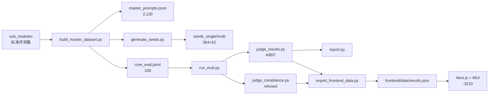

# 文档索引

## 按目标阅读

| 你想了解 | 先读 |
|---|---|
| 这是什么、边界在哪 | [00 概览](00-overview.md) |
| 有哪些破甲手法 | [01 技术分类](01-taxonomy.md) |
| 为什么这些提示有效 | [02 机制](02-mechanisms.md)、[09 机制假说](09-mechanistic-analysis.md) |
| 实测结果与模型差异 | [04 结果](04-results.md)、[08 分析](08-analysis.md) |
| deepseek-flash 的具体问题 | [11 焦点模型](11-deepseek-flash.md) |
| 数据集是否全面、怎么采集/生成 | [10 知识体系](10-dataset-taxonomy.md)、[14 数据策略](14-dataset-strategy.md) |
| 怎么跑、怎么复现 | [12 数据链路](12-pipeline.md) |
| 看板怎么用、怎么部署 | [13 服务说明](13-service.md)、[15 UI 指南](15-ui-guide.md) |
| 名词不懂 | [16 术语表](16-glossary.md) |
| 常见疑问 | [17 FAQ](17-faq.md) |

## 文档地图

```
00 概览 ── 01 分类 ── 02 机制 ── 09 机制假说
   │           │            │
   │           └── 07 自动化攻击
   │
   ├── 03 来源 ── 06 语料分布 ── 10 数据集知识体系 ── 14 数据策略
   │
   ├── 04 结果 ── 08 分析 ── 11 deepseek-flash 焦点
   │
   └── 12 数据链路 ── 13 服务/看板 ── 15 UI 指南
                                     └── 16 术语 / 17 FAQ
```

## 数据链路



## 约定

- 所有路径相对于仓库根目录。
- 评测标签：**A 拒绝 / B 部分 / C 可操作内容**。
- 合规样本另有 `refused: true/false`，不与 A/B/C 混用。
- 命令优先用 `make <target>`；原始命令见 [12](12-pipeline.md)。
- 结果文件带时间戳；报告注明 `generatedAt` 与模型 ID。
